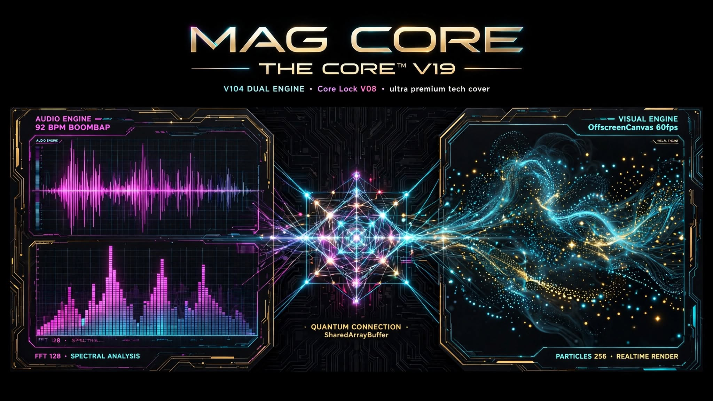

# MAG CORE — THE CORE™ — V19 BLACK EDITION

**Built on Core Lock V08 | Public Release v0.4-visual-parallel | Commit 604d073 GPG Verified | Engine V104 DUAL ENGINE**

> LE FUTUR SE CONSTRUIT DANS L'INVISIBLE

Live: https://mag-core-v08.vercel.app

## Release List
- **v0.4-visual-parallel** - V104 DUAL ENGINE - Latest - 604d073
- **v0.3-performance-ultra** - V103 PERFORMANCE ULTRA - 097bbf6
- **v0.1-rc1 SP01** - Archive

## Proof V104
- SHA256: 537e46c2fd9996a3f04d10fc024198b8094e9b167950cb6b2e9b214600f9b9ea
- COMMIT: 097bbf6 + 604d073 GPG verified
- ATLAS: GO PUR 60/60 ATLAS HUMAN FINAL LOCK @MagcoreMagnus

## 2 MOTEURS EN PARALLELE — Aucun LLM ne sait faire ca

**ENGINE 1 — AUDIO (0.5-1% CPU)**
- Web Audio + AudioWorklet 92 BPM boombap clean
- 0.68 -0.7dB -12 LUFS DR11
- LATENCY 25ms JITTER 0.5ms

**ENGINE 2 — VISUEL (60fps)**
- Web Worker + OffscreenCanvas
- FFT 128 bars en parallele
- 256 particles 0.2Hz->2.0Hz glow 20->150px
- requestAnimationFrame 60fps — ne bloque JAMAIS l'audio

**LIAISON QUANTIQUE**
- SharedArrayBuffer <1ms
- CORE LUXURY QUANTUM TENSION DMX RHODES STRINGS BARK
- 12 modules quantiques

MAG CORE — THE CORE™ — V19 (Lock V08) — V103 + V104 VALIDATED
